# Mapee Expanded

A fork of [Mapee](https://github.com/Voxelview/Mapee), the simple, yet powerful Minecraft mapper & filter, that adds **Bedrock Edition** worlds.<br>
Loads Java worlds from Alpha to the newest release, and Bedrock worlds from Pocket Edition 0.9 to the newest release.<br>
Upstream website: [mapee.net](https://www.mapee.net/home)

[Download the latest release](https://github.com/locodarwin/MapeeExpanded/releases/latest): for Windows x64, unzip and run `Mapee.exe`; for Linux x86-64, the AppImage (see "Linux" below). Neither needs installing.

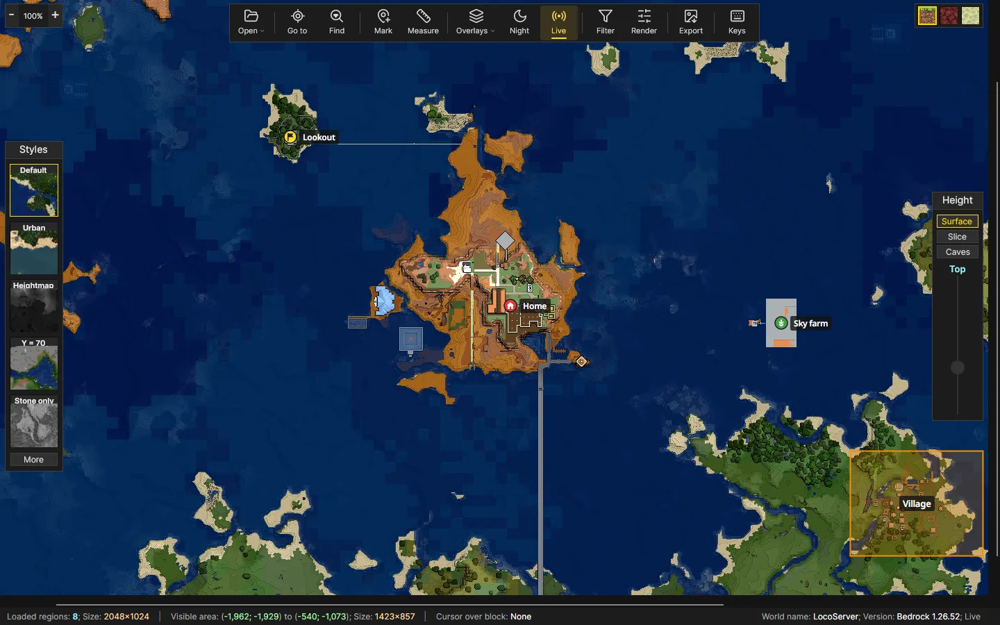

# What's New?
**Unreleased**
- Signs: the Find window's new **Signs** half lists every sign in the dimension and what it says, nearest first, with a box to search them by their words. Nothing is drawn until you tick a sign; ticked signs show on the map with their first line, everything they say when the mouse is over them, and are kept with the world's pins and zones (see "Signs" below). `mapee-cli signs` lists them

**Version 1.8.0**
- Structures: a new overlay marks the villages, strongholds, temples, monuments, fortresses and other structures the game has generated, with their names, and outlines the ground each covers. While it's on, Go to lists them nearest first, and typing a name there picks them out (see "Structures" below). `mapee-cli structures` lists them
- `mapee-cli watch` keeps a web map up to date while the game is played, drawing the regions it saves every half minute or so (see "Command line" below)

**Version 1.7.0**
- Where mobs can spawn: a new overlay shades every block a hostile mob could spawn on at night, so you can see what still needs a torch. With a height cut it shows the floors under the cut, inside a building or a cave (see "Where mobs can spawn" below)
- Nether portals: a new overlay marks each portal in the Overworld and the Nether with where it leads, and shows in red a portal that leads into one whose way back goes to a different portal (see "Nether portals" below). `mapee-cli portals` lists them
- The info bar gives the block under the mouse's place in the other dimension (divided by 8 in the Overworld, multiplied by 8 in the Nether), for lining up a portal

**Version 1.6.0**
- A tidier toolbar: buttons in groups (a world, getting around, marking, what's drawn, how it's drawn, export, help), each with a label under a new icon that stays sharp on scaled screens and turns gold while on. **Open** browses for a world or picks a recent one; **Overlays** holds the grid, slime chunks, axes and chunk highlight, with a count of how many are on. In narrow windows the labels give way to icons only, and a right-click on the toolbar turns them off everywhere (see "The toolbar" below)
- Change any shortcut key: click it in the key list and press the new one (see "Keyboard shortcuts" below)
- Java worlds from 26.1 on show their Nether (Mapee looked in the wrong folder), and the player is placed where they really are, in the right dimension, rather than at the world spawn
- Web maps update: exporting a web map again into the same folder draws only the regions where the game has saved something since, and keeps the rest, so refreshing a big map takes seconds. Changing the style, block filter, height cut or render settings, or a new version of Mapee, draws everything again, as does the export window's **Redraw everything** (`--full` for `mapee-cli`). A web map made in the app can be updated from the command line and the other way round
- Find blocks: the toolbar's **Find** button (or F) searches the whole dimension for any block, or for ready-made groups (diamonds, ancient debris, spawners, chests and barrels, emeralds, buried things), and marks what it finds on the map, with a list of every vein or cluster, nearest first, to step through or put a pin on (see "Find blocks" below). `mapee-cli find` lists them for a script or a spreadsheet
- `mapee-cli render` images now match the web map's tiles pixel for pixel (both draw regions in the same groups of four, so neighbours are shaded the same way)
- Windows: measuring, and dragging the map, follow the mouse on a second monitor whose scaling differs from the main one's (the measurement used to land well to the right of the cursor)
- Windows: closing the Go to, Add block or custom-dimension window with its close button no longer throws an error
- Windows: `LICENSE.txt` and `THIRD-PARTY-NOTICES.txt` (the toolbar icons' licence) come with the app

**Version 1.5.0**
- Linux: an AppImage of Mapee, a second GUI written in Avalonia that looks and works like the Windows one (see "Linux" below)
- Remembers between runs: the window size, the style, which overlays are on (grid, slime chunks, axes, chunk highlight), and the worlds you opened recently, which head the world browser even when they live outside the usual folders. Reopening a world returns to the dimension, place and zoom you left it at. Settings are kept in `%APPDATA%\Mapee\Settings.json` (Windows) or `~/.config/Mapee/Settings.json` (Linux)
- Opens a world named on the command line (its folder, `level.dat` or a `.mcworld`), so a world can be dropped on `Mapee.exe` or opened with Mapee from a file manager
- Bedrock sky light spreads sideways into cave entrances and under overhangs, as in Java
- Older Bedrock worlds: chunks last saved before 1.18, all the way back to Pocket Edition 0.9, load with their blocks, biomes and heights. Blocks saved under old names (wool before it was split by colour, logs, stone variants and the like) are translated too, which also fixes stray chunks in newer worlds that hadn't been visited since an update
- Height panel on the right of the map: **Surface** is the style's own view, **Slice** draws the map as if the world stopped at the chosen height, and **Caves** shows the floors of the caves below it. Drag the slider or scroll over it (Shift for steps of 10); each dimension keeps its own height
- The info bar names the block under the mouse with its height and biome, as the map shows it (so it follows the height panel), and for water or lava, how deep it is and what's at the bottom
- Export as a web map: the export window's new **Web map** option renders the whole world, not only what has loaded, into a folder holding `index.html` and a tile pyramid for each of the Overworld, Nether and End the world has, each in the current style (and height cut, where the height panel is on). The page pans and zooms like an online map (mouse, touch, keyboard), switches between the dimensions, shows the block's X, Y and Z beside a resting mouse as Mapee does, marks the spawn and the player, has a region and chunk grid, and keeps the dimension and view in the address so a link opens where it was copied. It needs no internet and no server: open it from disk or put the folder on any web host. Any folder will do; if it already holds web map files, Mapee names them and asks before replacing them
- Coordinates beside the mouse: rest the mouse over the map for a moment and a small label gives the block's X, Y and Z
- Command line: `mapee-cli` draws a world without opening a window, a dimension into one PNG or the whole world into a web map, with the same styles and height cuts as the app (see "Command line" below)
- Markup: mark the map with labelled **pins** and labelled **zones** (territories, claims, farms, towns), each with a colour, a note, and for pins one of eight symbols. They're kept per world and per dimension, show in the Go to window and the web map, and can be drawn into exported images (see "Markup" below)
- Keyboard shortcuts for the dimensions, zoom, styles, height panel, overlays, markup and windows; F1, ? or the toolbar's keyboard button lists them, and each toolbar button's tooltip names its key (see "Keyboard shortcuts" below)
- **Recent** button beside Load world: the worlds opened lately, newest first, with their edition and when they were last opened; picking one opens it where the map was left. An × takes a world off the list (the world itself is never touched), **Clear the list** forgets all but the open one, and a world that has been moved or deleted shows dimmed and offers to come off the list. Ctrl+Shift+O opens it from the keyboard (Up, Down, Enter)
- Live reload: while a world is open, the map redraws what the game saves, chunk by chunk, and the info bar says what was updated and when. The toolbar's **Live** button (or W) turns it off and on. Java saves every five minutes, when the game is paused, or on `/save-all`, so that's how far behind Java can be; Bedrock writes more often. Worlds opened from a `.mcworld` are copies and don't change (see "Live reload" below)
- Drag and drop: drop a world folder, its `level.dat` or a `.mcworld` on the window to open it, or a markup `.json` file to add its pins and zones to the world on show. While dragging, the window says what dropping would do

**Version 1.4.0**
- Opens Bedrock Edition worlds: the world browser lists them next to Java worlds, and the open button takes a `level.dat` or a `.mcworld` file
- Bedrock block states and biomes are translated to Java's, so every style, filter and render setting works as it does for Java worlds
- Light is computed for Bedrock worlds, which don't save it, so night mode and cave views work
- Large worlds are indexed in the background; the map shows "Reading world" until it can draw
- No update check: the upstream updater would replace this fork with upstream Mapee

**Version 1.2.0** (upstream)
- Added Alpha support
- Added new blocks in 26.2

# Linux

The Linux build is a single AppImage, self-contained (no .NET needed). Make it executable and run it:

    chmod +x MapeeExpanded-1.8.0-x86_64.AppImage
    ./MapeeExpanded-1.8.0-x86_64.AppImage [world]

If it complains about FUSE, run it with `--appimage-extract-and-run`. It runs as a native Wayland app (following the monitor's scale, fractional ones too) and falls back to X11, where it takes the scale from `GDK_SCALE` or `AVALONIA_GLOBAL_SCALE_FACTOR`. The world browser looks in `~/.minecraft/saves` (Java) and `~/.local/share/mcpelauncher/games/com.mojang/minecraftWorlds` (Bedrock through mcpelauncher); anything else opens with Browse, or by dropping it on the window. Differences from Windows: the system's own window frame, and Go to, Add block and the custom-dimension list open as pop-ups under their buttons rather than as small windows. Given a command as its first argument (`render`, `webmap`, `watch`, `find`, `portals`, `structures`, `signs`, `worlds`, `styles`), the AppImage runs `mapee-cli` instead (see "Command line" below).

# The toolbar

From left to right, in groups:

| Button | Does |
|---|---|
| **Open** | Browse for a world, or pick one opened lately (with none yet, it browses straight away) |
| **Go to**, **Find** | Go to a place or a pin; find blocks anywhere in the dimension, or signs by what they say |
| **Mark**, **Measure** | Pins and zones; measure a length (only one of the two takes clicks at a time) |
| **Overlays** | Grid lines, slime chunks, axes, the chunk under the cursor, where mobs can spawn, the Nether portals and the structures, ticked on and off in its menu; the number on it says how many are on |
| **Night**, **Live** | Night lighting; redraw what the game saves while the world is open |
| **Filter**, **Render** | Which blocks are drawn; light, height offset and background |
| **Export** | Save the map as an image or a web map |
| **Keys** | The keyboard shortcuts, which can be changed there |

A button is gold, with a bar under it, while it's on. Each one's tooltip names its key. Where the window is too narrow for the labels, the buttons show icons only; right-click the toolbar and untick **Show labels under the icons** to have icons only everywhere.

# Markup

The toolbar's **Mark** button (the pin) opens a bar under the toolbar with what a click on the map does:

- **Pin**: click to drop a pin on the block, and give it a label, colour, symbol and note. Click a pin to change it.
- **Zone**: click each corner; double-click, press Enter or click the first corner to finish. Backspace takes the last corner back; hold Shift to snap corners to chunk corners.
- **Rectangle**: drag out a rectangular zone; hold Shift to take in whole chunks.
- **Select**: click a pin or zone to pick it, double-click to change it, Delete to remove it; drag a pin, or a picked zone's corners, to move them. On a picked zone, double-click an edge to add a corner there, or a corner to remove it.

Dragging still moves the map in every mode, and a right-click on any pin or zone changes it even with the bar closed. Hovering over a zone shows its size in blocks and chunks. Ctrl+Z and Ctrl+Y undo and redo while the bar is open. **Places** lists the dimension's pins and zones (click one to go there), and the Go to window lists them too. **Export** and **Import** move markup between machines or onto a copy of a world; **Hide** hides it until the Mark button (or Shift+M) brings it back. P, Z, R and V pick the four modes from the keyboard, opening the bar if it's closed.

Markup is saved as you go, one file per world in the settings folder (`%APPDATA%\Mapee\Markup` on Windows, `~/.config/Mapee/Markup` on Linux), never in the world itself. It follows the path the world was opened from, as the recent worlds do, so a copied world starts without it until you import it. Signs you've ticked in the Find window's Signs list are kept the same way (see "Signs" below). The export window's **Include pins, zones and signs** puts it in screenshots, full-resolution images and web maps; in a web map, click a pin, sign or zone to see its note or what it says, and **PINS** and **ZONES** (M and Z) switch them off.

# Find blocks

The toolbar's **Find** button (or F) opens a window for finding blocks anywhere in the dimension on show, underground ones too, not only what the map shows from above:

- **Look for**: type in the search box and press Enter, or double-click a block in the list, to add it. The buttons under the list add a ready-made group: **Diamonds** and **Emeralds** (their ores in stone and deepslate), **Ancient debris**, **Spawners** (trial spawners too), **Chests and barrels** (copper chests too) and **Buried things** (suspicious sand and gravel). Up to eight at once, each marked in its own colour; × takes one off.
- **From Y** and **to Y** keep the search between two heights; leave them blank for every height.
- **Find** reads the whole dimension in the background (a few seconds for most worlds) and the map fills in as it goes. **Stop** ends it early and keeps what it found.

Zoomed out, each chunk holding any gets a small square for each thing it holds, bigger and more solid the more there is, with the rarer ones on top so a spawner isn't lost among diamonds. Zoomed in to 200% or more, every block found is a dot. The list below merges blocks that touch (a vein of eight diamonds is one row) and gives each one's X, Y and Z, nearest the middle of the map first; **Sort from the map's middle** sorts it again from where the map is now. Clicking a row takes the map there and rings it; **Add a pin** marks it with a pin labelled with what it is and how deep ("Diamonds ×8, Y -58 to -55"). With Live on, regions the game saves are searched again. Switching dimension or world clears the results, and closing the window takes the marks away. Bedrock worlds are searched by the same names as Java ones. A search stops at a million blocks found; for something that common, narrow the heights.

# Signs

**Signs** at the top of the Find window (F) lists every sign in the dimension on show, standing, wall and hanging, with what it says, front and back, nearest the middle of the map first. Type in the box to list only the signs saying those words; blank signs are left out unless **Include blank signs** is ticked. Clicking a row takes the map there; **Add a pin** puts a pin on it, labelled with its first line.

Nothing is drawn on the map for a sign until its box is ticked. A ticked sign shows as a small sign with its first line beside it (where signs stand close together, only some have room for theirs), and with the mouse over it, everything it says and where it is. **Show all listed** ticks every sign in the list, so typing "home" and pressing it shows just the signs that mention home; **Hide all** takes them all off. Ticked signs are part of the world's markup: saved with its pins and zones, hidden and shown with them, listed by what they say in Go to, and drawn in exported images and web maps. Each time the dimension is read again (when the world opens, or when Live sees a save), a ticked sign takes on what it says now, and one that's been broken goes. `mapee-cli signs <world>` lists the signs too (`--text <words>` for only those saying them, `--csv` for a spreadsheet).

# Live reload

With **Live** on (the toolbar's **Live** button, on by default and remembered), Mapee looks at the open world's files every two seconds. That look is only a folder listing; nothing is read until the files have stopped changing for a whole look, so a save in progress is never read halfway (if the game keeps writing for ten seconds, Mapee reads anyway). Then:

- **Java**: each region file that changed is drawn again; the save times inside it say how many chunks the game wrote. Newly explored regions appear.
- **Bedrock**: Mapee opens the world's database again and reads only the records written since its last look (every record carries a sequence number), so it knows exactly which chunks changed without reading the rest of the world. Light reaches across chunk edges, so a chunk on a region's edge redraws the region beside it too.

Each region keeps its old picture until the new one is ready, so the map doesn't flash. Only the dimension on screen is watched; the others catch up when you switch to them. The player's position (Go to's **Player position**) follows `level.dat`. If the game keeps its files locked, the info bar says Mapee can't read the world and it tries again.

# Where mobs can spawn

Tick **Where mobs can spawn** in the Overlays menu (or press D) to shade red every block a hostile mob could spawn on at night, in the Overworld and the End. Light a red patch with a torch and, once the game has saved, the red goes (with Live on, by itself). The rules are those of the game since 1.18, Java and Bedrock alike:

- the block has to be solid with a full top: not glass, leaves, ice, a bottom slab, stairs the right way up, a carpet, a fence or wall, a chest and the like;
- there has to be room above it, two blocks of air or of things a mob can stand in (grass, flowers, torches, rails, signs, snow);
- the block light just above it has to be 0. Sky light doesn't count: at night it doesn't stop them;
- not in a mushroom field or the deep dark, where nothing hostile spawns. In the Nether, light doesn't stop mobs at all, so there's nothing to show.

From above, that's the ground the map shows, so in the open almost everything is red at night, and lit-up bases stand out. With the height panel on **Slice** or **Caves**, it shows the first floor below the cut instead: set the cut just above a floor of your base, or into the rock, to see the dark spots inside a building or in the caves. The overlay is drawn when zoomed in to about 50% or closer (further out, it would mean reading much of the world), a region at a time as they come into view, nearest the middle first; Bedrock worlds take a little longer, since their light is worked out rather than saved. Spawners, which spawn whatever the light, aren't shown; Find blocks finds them.

# Nether portals

Tick **Nether portals** in the Overlays menu (or press O) to mark the portals in the Overworld and the Nether. Each one is labelled with the portal it leads to in the other dimension, with a dashed line to where that portal stands in this one (its place multiplied or divided by 8):

- **purple**: it leads to a portal that leads back to it;
- **amber**: nothing near enough on the other side, so the game would build a new portal there; the label gives where;
- **red**: it leads to a portal whose way back goes to a different portal, so going through and straight back lands somewhere else. The label names that other portal. Moving one of the two, or building a portal where the red one should arrive, fixes it.

Mapee links them as the game does: going into the Nether, it takes the portal nearest the matching place within 16 blocks each way; coming back, within 128. It reckons from the middle of each portal, so a wide portal stepped into at one end can, now and then, lead elsewhere. The portals are found once, when the overlay is first turned on (a few seconds), and found again when Live redraws something.

The info bar also gives the place under the mouse in the other dimension: "Nether: (12; -40)" in the Overworld, "Overworld: (96; -320)" in the Nether. `mapee-cli portals <world>` lists every portal, where it leads and whether it leads back (`--csv` for a spreadsheet).

# Structures

Tick **Structures** in the Overlays menu (or press T) to mark the structures of the dimension on show: villages, strongholds, ancient cities, trial chambers, woodland mansions, ocean monuments, temples, witch huts, igloos, outposts, ruined portals, shipwrecks, ocean ruins, buried treasure, Nether fortresses, bastions and End cities. Each has a dot in its own colour and its name, where there's room for it (the bigger finds win the room), and when zoomed in far enough, a dashed outline of the ground it covers. Mineshafts and Nether fossils, which are everywhere, are left out.

While the overlay is on, **Go to** lists the structures under the pins and zones, nearest the middle of the screen first; type a name, such as "village" or "strong", to see only those, and Enter goes to the first.

What Mapee can show depends on the edition, since it reads what the game saved rather than working it out from the seed:

- **Java** saves every structure it generates, with the chunk it starts in, so they're all there: everything in the ground the game has generated so far, explored or not. Data pack structures are named from their ids. Ground generated before 1.13 and not saved since kept its structures elsewhere, and those don't show.
- **Bedrock** saves only some: where Nether fortresses, witch huts, ocean monuments and pillager outposts spawn their mobs, and the villages that have had villagers in them. Strongholds, ancient cities and trial chambers are found by blocks only they have (end portal frames, reinforced deepslate, trial spawners and vaults), which takes a few seconds more. Other kinds don't show.

Each dimension is read the first time it's shown with the overlay on, and again when Live redraws something. `mapee-cli structures <world>` lists them all, with the box each covers (`--csv` for a spreadsheet).

# Keyboard shortcuts
Press **F1** or **?** in the app, or the toolbar's **Keys** button, for this list. None of them work while you're typing in a box, and the ones that need a world do nothing until one is open.

| Keys | Does |
|---|---|
| Arrows | Move the map; with Shift, a quarter of the screen at a time |
| + − | Zoom in, out |
| 0 or Ctrl+R | Back to 100% |
| 1 2 3 | Overworld, Nether, End |
| 4 – 9 | Custom dimensions, in their list's order |
| , . | Previous, next style |
| H | Height panel: Surface, Slice, Caves in turn |
| [ ] | Height down, up; with Shift, by 10 |
| G S A C D O T | Overlays: grid lines, slime chunks, axes, chunk highlighter, where mobs can spawn, Nether portals, structures |
| L | Measure length |
| N | Night mode |
| W | Live reload on or off |
| M | Markup bar |
| Shift+M | Show or hide pins and zones |
| P Z R V | Markup: Pin, Zone, Rectangle, Select |
| Ctrl+Z Ctrl+Y | Undo, redo markup (while the bar is open) |
| Ctrl+G | Go to a place, with the cursor in the coordinate box (or type a name to pick a pin, zone, structure or ticked sign) |
| F | Find blocks or signs |
| Ctrl+E | Export as image or web map |
| Ctrl+O | Browse for a world |
| Ctrl+Shift+O | The Open menu: recent worlds (Up, Down and Enter pick one) |
| Ctrl+F | Filter blocks |
| F11 | Full screen, on Windows (Esc leaves it); on Linux the window manager's own key does this |

To change a key, click it in that list and press the new one, with Ctrl or Shift if you like (Esc cancels). If another action had that key, it moves, and the list says which action lost it; that action has no key until you give it one. **Reset** beside a changed key gives back the one it came with, and **Reset all keys** undoes every change. The arrows, the 1 – 9 dimension keys and Esc can't be changed, and the height keys bring their Shift step of 10 with them. Tooltips and the list always show the keys as they are now.

Only your changes are saved, under `"Keys"` in `Settings.json`, by action name, with `""` for an action you've left without a key:

```json
"Keys": {
  "Grid": "Shift+G",
  "Axes": "G"
}
```

An entry Mapee can't read is skipped, and that action keeps its usual key.

# Command line

`mapee-cli` comes with Mapee: `mapee-cli.exe` beside `Mapee.exe` on Windows; on Linux the AppImage runs it when its first argument is a command (`Mapee.AppImage render ...`). It draws the way the app does, and needs no display, so it can run from a script or a scheduled task.

```
mapee-cli render <world> --out map.png [--dimension overworld|nether|end] [--area x1,z1,x2,z2] [--markup]
mapee-cli webmap <world> --out <folder> [--dimension overworld,nether] [--no-markers] [--force] [--full]
mapee-cli watch <world folder> --out <folder> [--every 30] [webmap's options but --full]
mapee-cli find <world> --block diamonds,spawner [--dimension nether] [--area x1,z1,x2,z2] [--y min,max] [--csv]
mapee-cli portals <world> [--csv]
mapee-cli structures <world> [--dimension overworld,nether] [--csv]
mapee-cli signs <world> [--dimension overworld,nether] [--text <words>] [--csv]
mapee-cli worlds          # the worlds in the game's world folders
mapee-cli styles          # the style ids
```

- `<world>` is a world folder, its `level.dat`, a `.mcworld`, or the name of a world that `mapee-cli worlds` lists.
- `render` writes one dimension at a pixel per block, transparent where nothing has been generated; `--area` keeps the blocks between two corners. It prints where the image lies in block coordinates.
- `webmap` writes the same web map as the export window, every dimension the world has. An earlier web map in the folder is replaced without asking, so a map can be kept up to date from a script; other files that would be replaced need `--force`. Over an earlier web map of the same world drawn the same way, only the regions the game has saved since are drawn, and the result line says how many (`Updated: Overworld: 3 of 26 regions changed`); `--full` draws everything.
- `watch` does what `webmap` does, then keeps looking at the world's files: every 30 seconds (or `--every` seconds), if the game has saved anything, it updates the web map, drawing only what changed, and prints a line saying what (`14:02:31  Overworld: 2 of 26 regions changed`). Leave it running beside the game, with the folder served to your friends, and the map keeps up. It needs the world's folder, not a `.mcworld`. Ctrl+C stops it. A save it catches halfway is tried again next time.
- `find` prints one line per block found, `x y z` and what it is, and a summary on the error stream. `--block` takes Java block names (`diamond_ore`, `ancient_debris`, also for Bedrock worlds) or the groups `diamonds`, `ancient_debris`, `spawners`, `chests`, `emeralds` and `buried`; `--y` keeps between two heights, `--area` between two corners, and `--csv` writes `x,y,z,block` with a header line, for a spreadsheet.
- `portals` prints each Nether portal in the Overworld and the Nether, the portal it leads to (or where the game would build one) and, when that portal leads back somewhere else, where; `--csv` writes a line for each with `leads_back` yes or no.
- `structures` prints each structure, every dimension the world has, as the overlay finds them (see "Structures" above): its name and the middle of the box it covers, marked "(found by its blocks)" for a Bedrock stronghold, ancient city or trial chambers. `--csv` adds the box's corners and `known_by` (`saved` or `blocks`).
- `signs` prints each sign with something on it, every dimension the world has: where it is and what it says, the back after a slash. `--text` keeps only the signs saying all the words given, in any case; `--csv` writes `dimension,x,y,z,kind,front,back`, each side's lines on lines of their own.
- `render`, `webmap` and `watch` take `--style <id>` (default `default`), and `--slice <y>` or `--caves <y>` to draw as the height panel's Slice or Caves would.
- Markup: `render --markup` draws the pins, zones and ticked signs marked on the world in Mapee; `webmap` includes them unless `--no-markers` (which also leaves out the spawn and player). `--markup <file.json>` uses a file from the bar's Export instead.
- Exit codes: 0 done (and for `watch`, stopped with Ctrl+C), 1 failed or nothing to draw, 2 wrong usage, 130 cancelled.

# Screenshots

All of these are from one Bedrock world, drawn by the Linux build (the Windows one looks the same inside its own window frame).

**Find blocks**: spawners and chests, nearest first, marked on the map

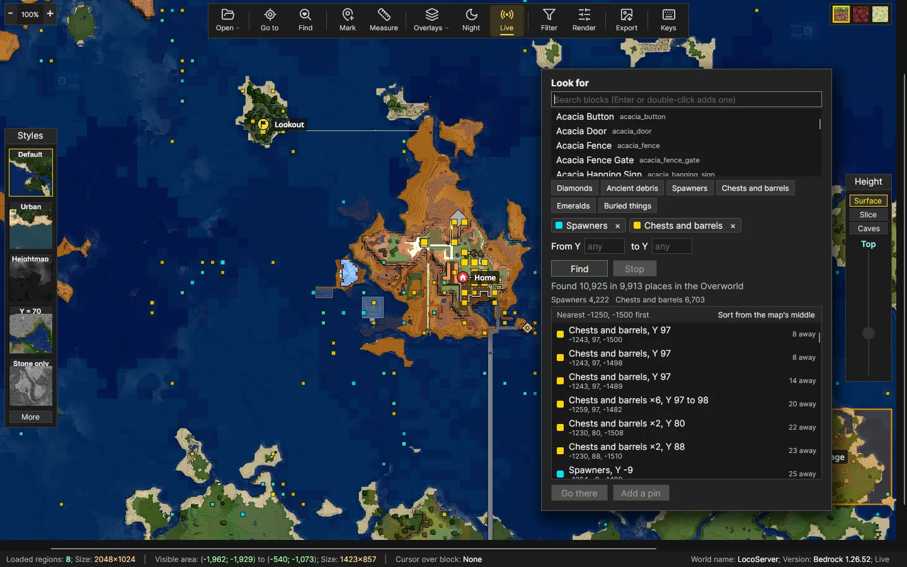

**Markup**: pins and zones, with the editor open on a new pin

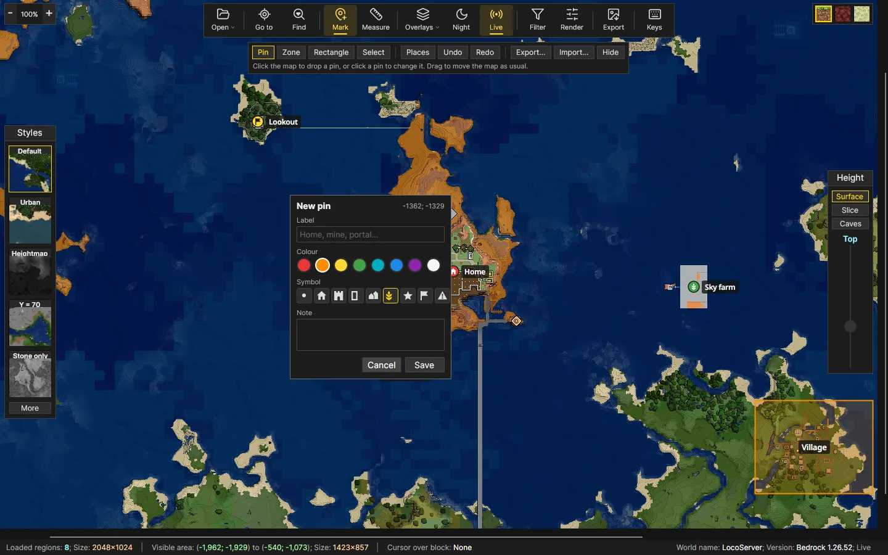

**Overlays**: grid lines and slime chunks, ticked in the Overlays menu

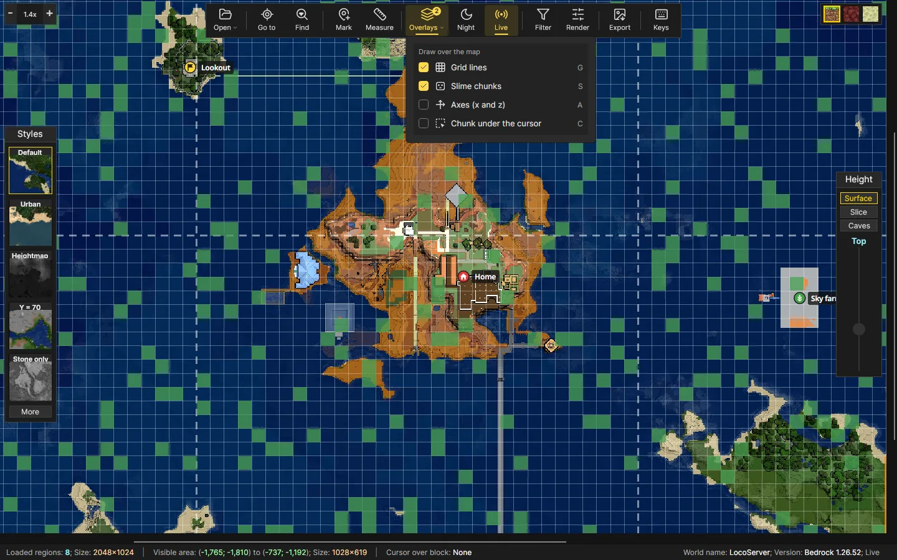

**Height panel, Caves**: the cave floors below Y 20

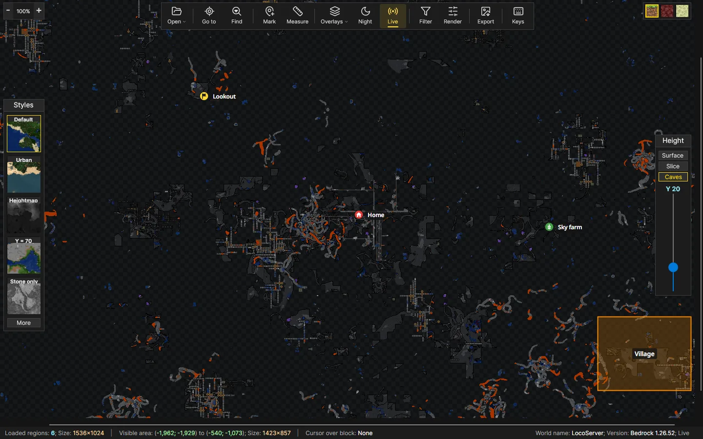

**Night mode**

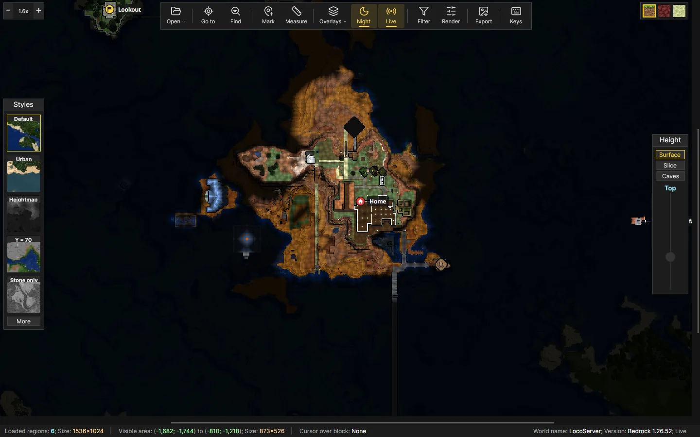

**The Nether** and **the End**, with an End city

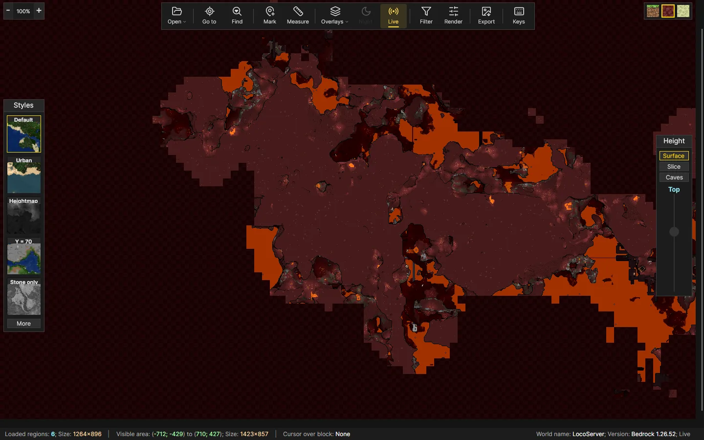

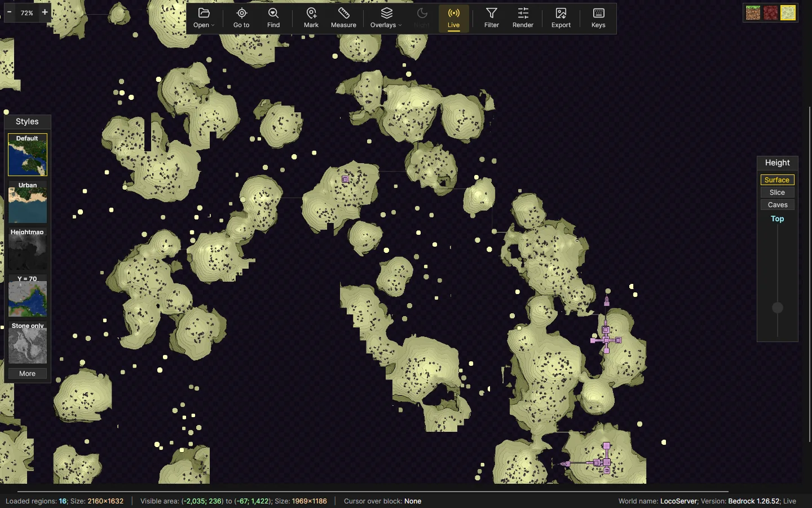

**Web map**: the same world exported, in a browser, with its pins and zone

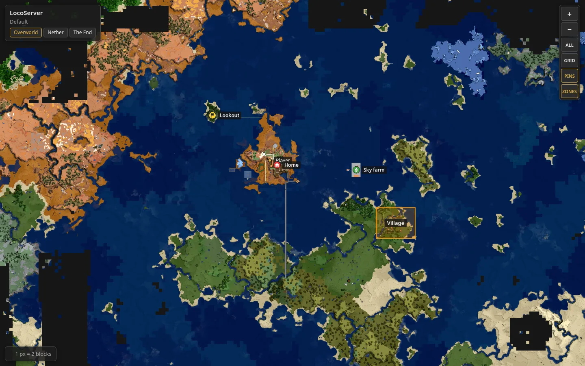

# Sample renders

From `mapee-cli render`, one pixel per block, the same 640 by 400 block area in each style.

| | |
|---|---|
| 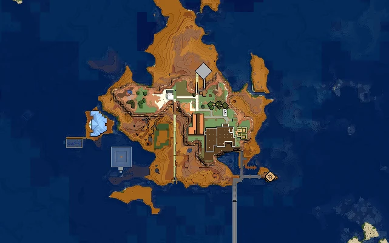<br>Default | 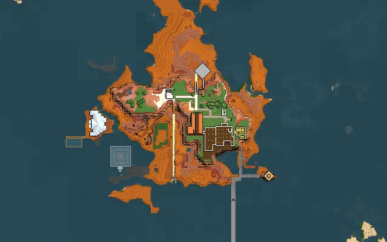<br>Urban |
| 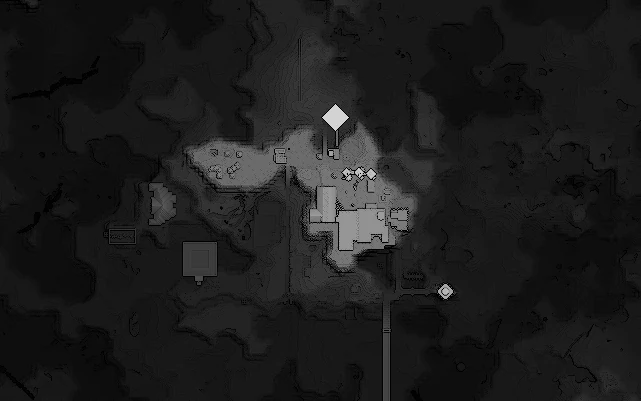<br>Heightmap | 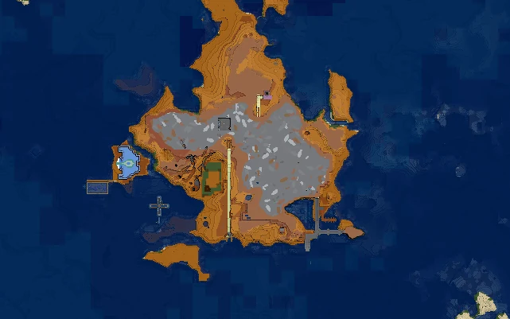<br>Y = 70 |
| 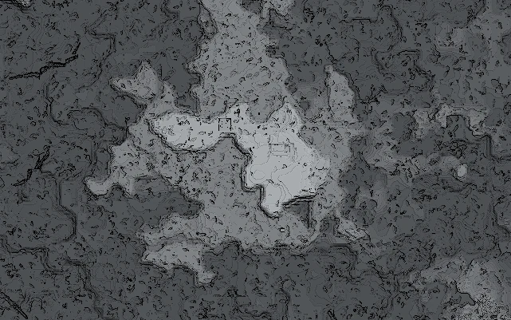<br>Stone only | 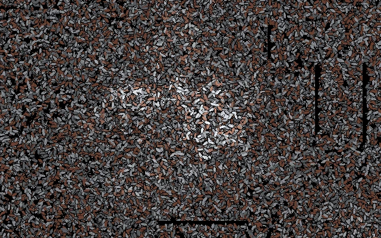<br>Igneous (granite, andesite, diorite) |
| 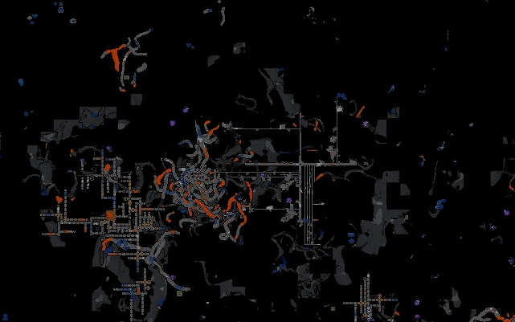<br>`--caves 20` | 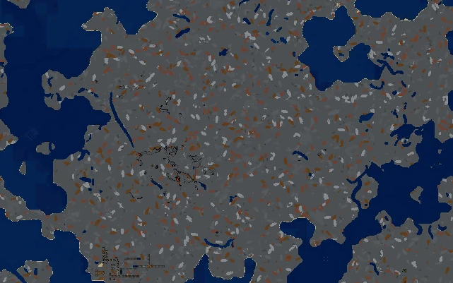<br>`--slice 40` |
| 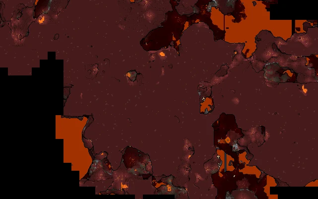<br>Nether | 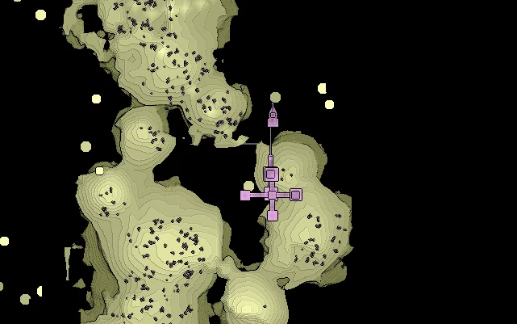<br>The End, an End city |
